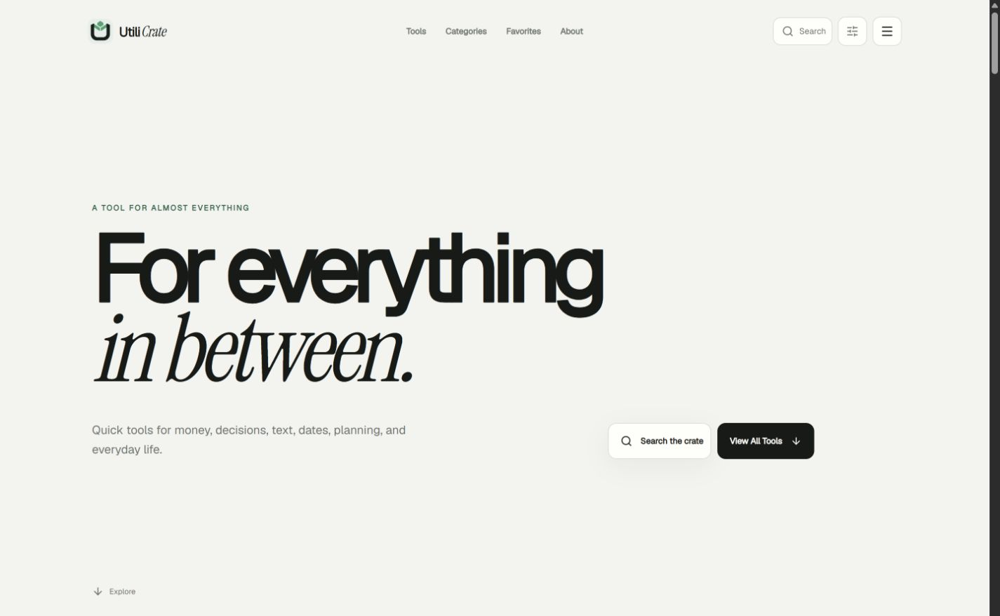
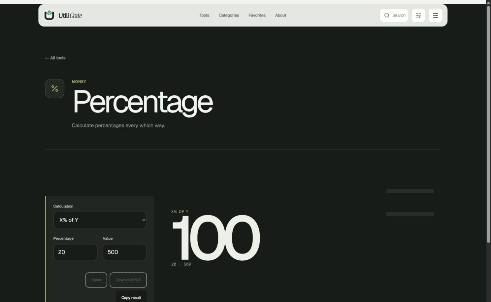
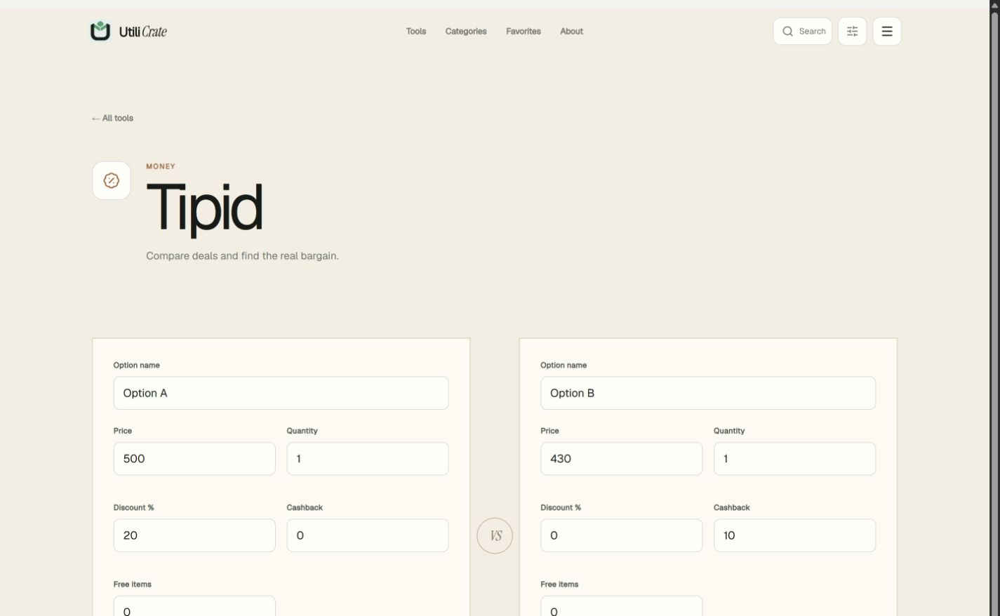
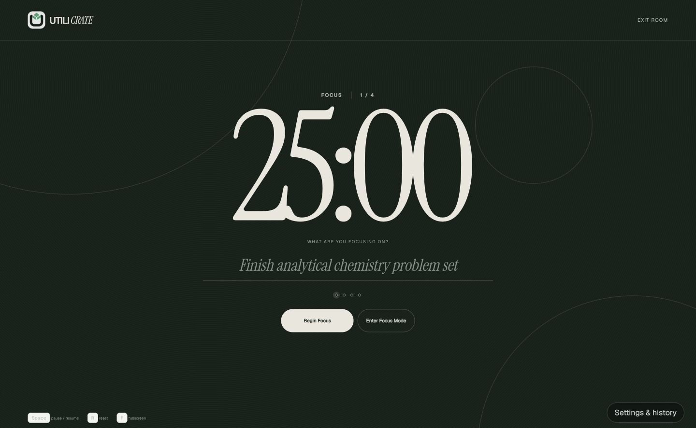
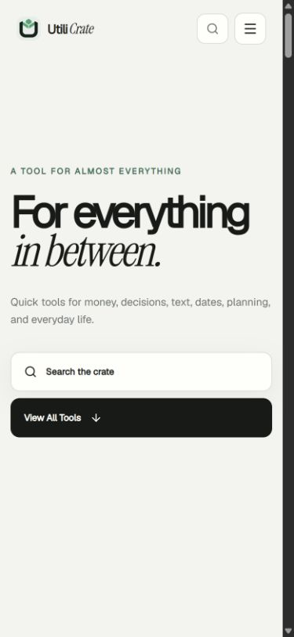

<div align="center">
  
  <h1>UtiliCrate</h1>
  <p><strong>Useful tools. One place.</strong></p>
  <p>A polished, local-first collection of 25 everyday utilities for money, decisions, text, dates, planning, focus, creativity, and health.</p>
</div>



## What is UtiliCrate?

UtiliCrate turns small everyday tasks into thoughtfully designed mini-apps. Every tool has its own visual identity while sharing one fast, accessible interface.

- **25 focused utilities** with purpose-built layouts and interactions
- **Standard and Simple dashboards** for expressive browsing or quick access
- **Local-first persistence** using browser storage—no account required
- **Premium PDF exports** for calculations, plans, comparisons, and reports
- **Optional sound and motion** with reduced-motion support
- **Responsive design** built for phones, tablets, laptops, and desktops
- **No AI APIs or external database** in the core tool experience

## A different interface for every job

| Mathematical clarity | Head-to-head comparison |
| --- | --- |
|  |  |

### FocusRoom

FocusRoom is UtiliCrate's intentional outlier: an immersive focus timer with session modes, history, fullscreen support, and optional completion sounds.



### Designed for small screens

The dashboard and every tool adapt intentionally to narrow viewports, with touch-friendly controls and no page-level horizontal scrolling.

<p align="center">
  
</p>

## Tools

| Category | Utilities |
| --- | --- |
| **Money** | Ambag, Allowance, Tipid, UnitPrice, ReceiptSplit, Percentage, SaveUp, TripCost, FuelCost |
| **Decisions** | Decide, PickForMe, Prioritize, WeighIt |
| **Text & Lists** | TextFix, ListCleaner, Glyphs |
| **Date & Time** | HowLong, TimeAgo, AgeCalc, Until, WeekNo |
| **Planning** | Pack |
| **Focus** | FocusRoom |
| **Creative** | Swatch |
| **Health** | BodyIndex |

## Local-first by design

Core calculations and transformations run in the browser. Saved items and preferences stay on the current device through `localStorage` or IndexedDB where implemented.

There are no required accounts, cloud sync services, AI APIs, or external databases. Clearing browser or site data can remove locally saved information.

## Run locally

Requirements: Node.js 22.13 or newer.

```bash
git clone https://github.com/chnlcbll/UtiliCrate.git
cd UtiliCrate
npm install
npm run dev
```

Open [http://localhost:3000](http://localhost:3000).

## Quality checks

```bash
npm test
npm run lint
npm run build
```

## Technology

- React 19 and TypeScript
- Next.js-compatible app structure powered by vinext and Vite
- Lucide icons
- `pdf-lib` with locally packaged typography for browser-generated reports
- Browser-native storage, canvas, fullscreen, notifications, and download APIs

## Project principles

1. Make the user's task the visual focus.
2. Give each tool an interface shaped by what it does.
3. Keep shared components accessible and maintainable.
4. Preserve local-first behavior and transparent calculations.
5. Treat mobile layouts as intentional designs, not shrunken desktops.

---

<div align="center">
  <strong>UtiliCrate</strong><br />
  Useful things, kept together.
</div>
